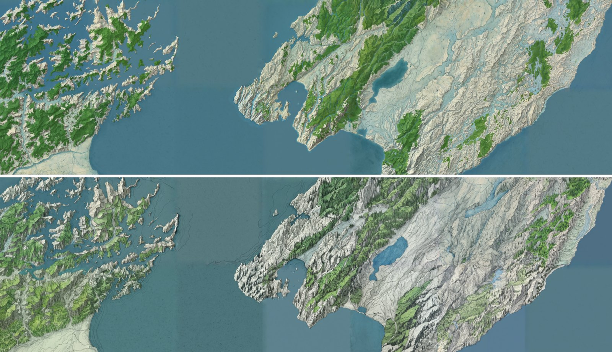

# argus-atlas

[](https://pypi.org/project/argus-atlas/)
[](https://pypi.org/project/argus-atlas/)
[](https://github.com/smk762/argus-atlas/blob/main/LICENSE)
[](https://github.com/smk762/argus-atlas/actions/workflows/ci.yml)

Bake one georeferenced fantasy-map overlay from real terrain.

`argus-atlas` warps a DEM into hillshade, slope, and land-mask control rasters with GDAL, restyles them through a diffusion backend with a cartography LoRA, stamps the painted pixels back onto the original geotransform, and cuts a PMTiles archive you can drape on a real map.



Cook Strait, New Zealand: the Marlborough Sounds on the left, Wellington and the Wairarapa on the right, as the [Realms demo](https://realms.dragonhound.dev) shows it. Each style is a block of 1024 px z10 chunks (`argus-atlas chunks`, 128 px seam margin, native zoom 12, 38 m/px) from Copernicus GLO-30 and OpenStreetMap layers, mosaicked into one tile set (`argus-atlas mosaic`). Juggernaut XL, no LoRA, 30 steps, cfg 6: preset `antique` at denoise 0.6 (top) and `tolkien` at 0.7 (bottom), seeds derived from each recipe and tile. Every chunk passed the alignment gate twice, once for its canvas and once for its crop, so coastlines run on across the seams and sit on the real ones when the layer is draped over a basemap.

**Status:** 0.x, pre-1.0: the CLI and `job.json` may still change between minor versions. Real AOIs pass the alignment gate, from single canvases (Lake Garda, October 2026) to blocks of seam-aware chunks (Cook Strait).

**Docs:** [your first bake](https://github.com/smk762/argus-atlas/blob/main/docs/your-first-bake.md) on a GPU host · [styles](https://github.com/smk762/argus-atlas/blob/main/docs/styles.md) and the knobs that matter · [chunks, mosaics and place names](https://github.com/smk762/argus-atlas/blob/main/docs/chunks-and-mosaic.md) · [the alignment gate](https://github.com/smk762/argus-atlas/blob/main/docs/alignment-gate.md) · [relief and the z factor](https://github.com/smk762/argus-atlas/blob/main/docs/relief.md) · [data sources](https://github.com/smk762/argus-atlas/blob/main/docs/data-sources.md) · [CLI reference](https://github.com/smk762/argus-atlas/blob/main/docs/cli.md)

Part of the [Argus suite](https://github.com/smk762?tab=repositories&q=argus).

## Why this exists

Every piece of this pipeline already exists somewhere. No package puts them together, and none of them carries coordinates through the generative step. That gap is the product.

| What `argus-atlas` guarantees | Why nothing on PyPI does it today |
|---|---|
| **Georeferencing survives generation.** The job sidecar is the coordinate authority. It is written before the model runs and checked after. An output that is one pixel off, or in the wrong CRS, is refused and no GeoTIFF is written. | ComfyUI workflows and ControlNet research code (`generative-ai-mapmaking`, `map-sat`, "Fantasy Maps from Height Maps") produce PNGs. Coordinates go in, pixels come out, and nothing reattaches the two. |
| **Provenance in the manifest.** Every job records the SHA256 of the source DEM, of each control PNG, and of the checkpoint and LoRA, plus the exact GDAL argv that ran. | Terrain tools (`xdem`, `richdem`, `nst-guide/terrain`) write rasters and stop. ComfyUI clients (`pycomfy`, `comfy-commander`, `comfy-api-client`) submit graphs and return images. Neither side keeps a record you could reproduce from. |
| **Tiles bounded to the AOI and capped at native resolution.** The archive never contains a tile outside the bounding box and never invents a zoom finer than the canvas. | `rio-pmtiles` cuts tiles from any GeoTIFF but will happily over-zoom a 1024-pixel canvas. `gdal2tiles` and `gdal raster tile` emit XYZ directories with no PMTiles packer. `rio-mbtiles` and `mbutil` are unmaintained. |
| **Canvas sized for Web Mercator, not for the model.** The AOI is fitted to a canvas whose long side is at most 1536 and whose sides are multiples of 64. If the AOI cannot fit at the requested resolution, the job fails and tells you the largest extent that would. | Diffusion front-ends size images for the sampler. Nothing resamples with the ground resolution and the resulting Web Mercator zoom in mind, and nothing refuses to silently downsample a continent into 1024 pixels. |
| **Demo-safe by default.** Baking is off unless `ATLAS_ALLOW_BAKE=1`. Stored jobs, previews, and archives stay readable. Paths in API requests are confined to configured roots. | Hosted generation wrappers either expose the GPU to anyone who can reach the port, or hide finished work when the GPU is gone. |
| **CLI first, server second.** `controls`, `bake`, and `tiles` run with no HTTP server and no studio. The FastAPI app is a thin wrapper for `argus-studio`. | Most of the comparable work is a notebook, a QGIS print layout, or a node graph that only runs inside a UI. |
| **Weights are mounted, never bundled.** The image contains GDAL and Python. The checkpoint and LoRA live on the host and are hashed into the job. | `pycomfy` downloads checkpoints on demand. `imaginAIry` runs the model in-process and does not support SDXL ControlNet. |

The nearest off-the-shelf neighbours and where they stop:

- **Terrain analysis:** `xdem` (active) and `richdem` (last release 2018) compute hillshade and slope as arrays. No 8-bit PNG export for a model, no sidecar, no canvas constraints.
- **Tiling:** `rio-pmtiles` (active, Protomaps) is the only maintained GeoTIFF-to-PMTiles route and is a candidate for the `tiles` extra. It has no alignment gate and no native-zoom ceiling. GDAL's own PMTiles driver is vector-only.
- **ComfyUI clients:** none implement a placeholder contract where a missing placeholder is an error that names it, and none know what a hillshade is.
- **Procedural generators:** `worldengine` renders "ancient style" maps, but only from its own simulated worlds, never from a real DEM.
- **Research code:** `generative-ai-mapmaking` trains an SD 1.5 ControlNet on Swisstopo vector tiles. Scripts only, no DEM input, no georeferencing after generation, seams left to the reader.

## OSM layers and the composite

The hillshade tells the model where relief is, not where water, forest, towns or roads are. `argus-atlas osm` fetches those from OpenStreetMap for the same bbox, scale-aware (at zoom 11 you get motorways and primaries, not footpaths), and `controls --layer` burns each one to a mask on the canvas grid. The known layers are also painted over the hillshade into `composite.png`; the packaged `comfyui_sdxl_img2img_composite_nolora` template uses that as the img2img init image, so lakes come out blue and forests green while the ControlNet keeps the ridges where the DEM put them.

```bash
argus-atlas osm --bbox 10.55,45.40,10.95,45.90 --zoom 11 --layers water,rivers,roads,forest,urban --out osm/garda
argus-atlas controls --dem dem.tif --bbox 10.55,45.40,10.95,45.90 --out jobs/garda-2 \
  --layer water=osm/garda/water.geojson --layer rivers=osm/garda/rivers.geojson \
  --layer roads=osm/garda/roads.geojson --layer forest=osm/garda/forest.geojson --layer urban=osm/garda/urban.geojson
ATLAS_ALLOW_BAKE=1 argus-atlas bake jobs/garda-2 --checkpoint <ckpt> --workflow comfyui_sdxl_img2img_composite_nolora.json
```

Any OGR-readable file works as a layer, in any CRS; a name outside the palette is burnt as a mask only and is available to a template as `$<name>`. Where to get such files (HydroSHEDS, Natural Earth, Geofabrik extracts, GADM, land cover …) is in [`docs/data-sources.md`](https://github.com/smk762/argus-atlas/blob/main/docs/data-sources.md). OSM data is ODbL; `osm.json` records the query and the data timestamp so the attribution can be traced.

## Presets and provenance

`argus-atlas presets` lists seven named styles: six recommended (antique, imhof, tolkien, watercolor, minecraft, pixel) plus cyberpunk, kept but not recommended (see [`docs/styles.md`](https://github.com/smk762/argus-atlas/blob/main/docs/styles.md)). `bake --preset <name>` uses one; the API has `GET /presets` and takes `preset` on the bake request, so a demo can offer a fixed menu instead of free-text prompts. Every output carries the full request: the PNG in an EXIF `ImageDescription` and a text chunk, the GeoTIFF in `TIFFTAG_IMAGEDESCRIPTION`, the PMTiles archive in its metadata. `exiftool fantasy.png`, `gdalinfo fantasy.tif` or `argus_atlas.metadata.read_png_payload()` give it back, which is what makes a hundred bakes rankable later.

## Chunks, mosaics and place names

A map larger than one canvas is baked one XYZ tile at a time. `argus-atlas chunk --tile z/x/y --recipe <style>` paints a tile plus a margin, with the chunks of the same recipe already baked around it pasted into the margin, so the model continues their coastlines and colours across the seam. The margin is then cut off and the crop is gated against the tile's own grid. `argus-atlas chunks` bakes a whole block in seam order from one DEM and OSM fetch, skips all-sea chunks and resumes where it stopped. `argus-atlas mosaic` combines a style's chunks into one tile set, with overview zooms for zooming out. A **recipe** (a JSON file such as [`examples/recipes/antique.json`](https://github.com/smk762/argus-atlas/blob/main/examples/recipes/antique.json)) pins the preset, checkpoint, LoRA, workflow and a per-tile seed, so re-baking a chunk gives the same image.

```bash
argus-atlas chunks --tile 10/1009/641 --rings 3 --recipe antique --out maps/antique \
  --sea-level 0 --allow-missing --land land.gpkg --labels --plan   # drop --plan to bake
argus-atlas mosaic maps/antique --out maps/antique.pmtiles
```

Place names never reach the model, which paints illegible lettering. `argus-atlas labels` writes them as a GeoJSON overlay from Natural Earth, a Geofabrik extract or the `places` layer of `argus-atlas osm`, ranked by zoom, and the viewer draws it on top in a real font.

[`docs/chunks-and-mosaic.md`](https://github.com/smk762/argus-atlas/blob/main/docs/chunks-and-mosaic.md) covers seams, tone matching, recipes, block fetches, resuming, the mosaic and labels in full. That is how the Realms demo was made.

## Live demo

- **[Realms](https://realms.dragonhound.dev)** drapes the Cook Strait chunk mosaic above over an OpenFreeMap basemap, with a style switch and an opacity slider: slide it to see the painted coastline sit on the real one.
- **[Argus Studio](https://studio.dragonhound.dev/atlas/)** is the suite's web UI; its Atlas page is a thin shell over this package's API.

To run it yourself, [`examples/flow.html`](https://github.com/smk762/argus-atlas/blob/main/examples/flow.html) runs the whole flow against a local server (AOI, OSM layers, controls, bake, tiles, drape) and [`examples/viewer.html`](https://github.com/smk762/argus-atlas/blob/main/examples/viewer.html) drapes any baked job on a MapLibre basemap with an opacity slider: start `argus-atlas serve --cors` (with `ATLAS_CORS_ORIGINS='*'`) and open the page, or feed it a `fantasy.pmtiles` directly. The first real AOI (Lake Garda, Copernicus GLO-30, Juggernaut XL, no LoRA) passed the alignment gate on 17 Oct 2026; [`docs/your-first-bake.md`](https://github.com/smk762/argus-atlas/blob/main/docs/your-first-bake.md) has the commands for your own.

## Quick start

GDAL is a system dependency, not a pip module. Install `gdal-bin` (Debian and Ubuntu), `gdal` (Fedora, Arch, Homebrew), or use the Docker image, which is built on `ghcr.io/osgeo/gdal:ubuntu-small-3.11.4` and already contains GDAL 3.11 and `gdal2tiles.py`.

```bash
uv pip install "argus-atlas[cli,tiles]"
argus-atlas doctor
```

Healthy `doctor` output names a GDAL version, lists `gdalwarp`, `gdaldem`, `gdal_rasterize`, `gdal_translate`, `gdalinfo` and the tiler it found, reports whether ComfyUI is reachable and whether baking is allowed, and says whether the Go `pmtiles` CLI is on `PATH` (informational only; packing uses the Python library). If GDAL is missing it says so and exits non-zero. Paste this output into any issue you open.

Then run the no-GPU half of the pipeline on the bundled sample DEM (`examples/sample_dem.tif`, southern Lake Garda from Copernicus GLO-30, 577x577 cells, 350 KB; in the source checkout or the sdist, not the wheel):

```bash
argus-atlas controls \
  --dem examples/sample_dem.tif \
  --bbox 10.60,45.44,10.76,45.60 \
  --out ./jobs/sample

argus-atlas inspect ./jobs/sample       # sidecar: geotransform, canvas size, SHA256s, GDAL argv
```

For your own AOI, fetch the DEM first. `argus-atlas dem` finds the Copernicus GLO-30 tiles the bbox touches on the public AWS bucket (no login), reads only the needed windows of the COGs, and writes one GeoTIFF on their own pixel lattice, snapped inside the bbox:

```bash
argus-atlas dem --bbox 10.55,45.40,10.95,45.90 --out dem/garda.tif   # provenance in dem/garda.json
argus-atlas controls --dem dem/garda.tif --bbox 10.55,45.40,10.95,45.90 --out ./jobs/garda
```

A tile the bucket lacks is an error that names it. Copernicus leaves out all-ocean tiles, so for a coast pass `--allow-missing` to fill them with 0 m, the sea level GLO-30 uses elsewhere. `--source` (or `ATLAS_DEM_SOURCE`) points at a mirror URL or a local directory laid out as `<key>/<key>.tif`. The command prints the Copernicus attribution; keep it with anything you publish. `controls` may widen the canvas past the bbox to reach whole multiples of 64 px, and cells outside the DEM become NoData, so pass `--cover` when the edges matter: it snaps the window outward instead, so the GeoTIFF contains the whole bbox, still on the lattice. For a chunk, `--tile z/x/y` (with the same `--size`/`--margin` as `chunk`) fetches exactly that chunk's canvas, margin included, and implies `--cover`. An AOI touching more than 16 GLO-30 tiles is refused unless you raise `--max-tiles`. There is no server route for this: it is an open-ended download plus a GDAL job, and it belongs with the operator who builds a job.

Open `jobs/sample/hillshade.png`. If the relief looks right, the georeferencing is already fixed; the bake only changes pixel colours inside that frame.

### Three ways to bake

| You have | Do this |
|---|---|
| **A local GPU with ComfyUI running** | `ATLAS_ALLOW_BAKE=1 argus-atlas bake ./jobs/sample --checkpoint ... --lora ...` as in the operator workflow below. The packaged ComfyUI workflow template is the starting graph; drop in your own. |
| **No GPU** | Run `controls` and `tiles` locally. A hosted notebook that runs the bake against a remote ComfyUI is planned (on the roadmap). |
| **ComfyUI, and you want to own the graph** | Start from `src/argus_atlas/templates/comfyui_sdxl_img2img_control.json`, keep the `$placeholders`, and point `ATLAS_WORKFLOW` at your copy. `bake` submits it, then stamps and gates the result. A standalone command for stamping a PNG painted outside atlas is on the roadmap. |

## Where it sits in the Argus suite

```
argus-quarry → argus-curator → argus-lens → argus-forge → trainer → argus-proof → argus-atlas
acquire          curate            caption      configs                  evaluate       bake
```

A cartography LoRA is trained with the existing suite and passed to atlas as a file. Atlas does not train, caption, or curate, and it does not modify the upstream packages.

## Operator workflow

```bash
# Controls only (no GPU). Inspect the hillshade before spending a bake.
# --bbox is EPSG:4326 degrees. The --out directory name becomes the job id.
argus-atlas controls \
  --dem ./dem.tif \
  --bbox west,south,east,north \
  --out ./jobs/aoi-1

# Size the canvas either by its long side (default 1024, cap 1536, multiple
# of 64) or by an explicit ground resolution in metres per pixel. Too fine a
# resolution for the AOI fails and prints the largest --bbox that would fit.
argus-atlas controls --dem ./dem.tif --bbox west,south,east,north \
  --long-side 1536 --out ./jobs/aoi-1
argus-atlas controls --dem ./dem.tif --bbox west,south,east,north \
  --resolution 30 --out ./jobs/aoi-1

# Optional land mask, rasterised onto the same grid as the warped DEM.
argus-atlas controls \
  --dem ./dem.tif \
  --bbox west,south,east,north \
  --land ./land.gpkg \
  --out ./jobs/aoi-1

# Bake through a ComfyUI already running on the host GPU.
# Refuses with exit code 3 unless ATLAS_ALLOW_BAKE=1.
ATLAS_ALLOW_BAKE=1 argus-atlas bake ./jobs/aoi-1 \
  --checkpoint sd_xl_base_1.0.safetensors \
  --lora fantasy_map.safetensors --lora-weight 0.8

# Everything else has a default: --prompt, --negative, --seed (random if
# omitted), --steps 30, --cfg 6.0, --denoise 0.55, --models-dir, --workflow,
# --comfyui-url. Pass --out to bake a variant into a copy of the job dir
# and keep the original.
ATLAS_ALLOW_BAKE=1 argus-atlas bake ./jobs/aoi-1 -c sd_xl_base_1.0.safetensors \
  --lora fantasy_map.safetensors --seed 7 --denoise 0.6 --out ./jobs/aoi-1-d60

# Tiles are a separate step so a bad stylisation can be rejected before a
# pyramid is built. Takes the job dir or its fantasy.tif, re-runs the
# alignment gate, then cuts --min-zoom..--max-zoom (never above native).
argus-atlas tiles ./jobs/aoi-1 --out ./jobs/aoi-1/fantasy.pmtiles

# Print the sidecar: geotransform, canvas, hashes, GDAL argv, bake params.
argus-atlas inspect ./jobs/aoi-1

# Thin HTTP wrapper for argus-studio. --host defaults to 0.0.0.0;
# --allow-bake overrides ATLAS_ALLOW_BAKE for this process.
argus-atlas serve --host 127.0.0.1 --port 8105 --cors

# Report GDAL version, ComfyUI reachability, and whether baking is allowed.
argus-atlas doctor
```

Exit codes: 0 success, 1 runtime failure, 2 input error, 3 baking disabled.

### What a job contains

```
jobs/aoi-1/
  job.json          # geotransform, CRS, canvas size, SHA256s, GDAL argv  ← coordinate authority
  dem_3857.tif      # DEM warped to EPSG:3857 and clipped to the AOI
  hillshade.tif     # gdaldem hillshade
  slope.tif         # gdaldem slope
  land_mask.tif     # gdal_rasterize of the optional polygon file (only with --land)
  hillshade.png     # 8-bit model inputs, no georeferencing of their own
  slope.png
  land.png          # only with --land
  fantasy.png       # raw model output, kept even if the gate fails
  fantasy.tif       # written only after the alignment gate passes
  fantasy.pmtiles   # zoom range native-2 .. native, bounded to the AOI
  labels.geojson    # place names for the viewer (only after `labels --job`), labels.json beside it
```

### Defaults

| Knob | Default | Notes |
|---|---|---|
| Canvas long side | 1024 | Hard cap 1536. Both sides multiple of 64. |
| Denoise | 0.55 | High enough to restyle, low enough that relief survives. |
| Steps / CFG | 30 / 6.0 | |
| Seed | random | Recorded in the sidecar so a bake can be repeated. |
| LoRA weight | 0.8 | |
| Prompt | `antique fantasy map, ink coastlines, parchment, illustrated relief, no text, no labels, no compass rose` | Labels and roses fight georeferencing and tile seams. |
| Negative | `text, watermark, letters, words, frame, border, photograph, satellite` | |
| Zoom range | native-2 through native, clipped to 0–14 | Native is the Web Mercator zoom closest to the canvas ground resolution. |
| Z factor | `auto` | Heights scaled by 1/cos(latitude) before hillshade and slope, undoing Web Mercator's horizontal stretch (×1.33 at 41°, ×2.37 at 65°). `--z-factor off` restores the uncorrected relief; `--vertical-exaggeration` multiplies on top. See [`docs/relief.md`](https://github.com/smk762/argus-atlas/blob/main/docs/relief.md). |

ControlNet choice and weight live in the ComfyUI workflow template, not in Python. The packaged template is a starting point the operator replaces.

### The ComfyUI workflow template

`src/argus_atlas/templates/comfyui_sdxl_img2img_control.json` is an API-format graph with `$placeholders` that `bake` fills: `$checkpoint`, `$lora`, `$lora_weight`, `$positive`, `$negative`, `$seed`, `$steps`, `$cfg`, `$denoise`, `$width`, `$height`, `$hillshade`, and optionally `$slope` and `$land`. Point `ATLAS_WORKFLOW` or `--workflow` at your own copy to change the sampler, the ControlNet, or anything else. Two rules:

- A placeholder the bake needs that is missing from the template is an error that names the placeholder.
- A template that contains `$lora` requires `--lora`.

The starter template names an SDXL depth ControlNet model directly; replace that name with whatever your ComfyUI has installed.

## The alignment gate

Before a GeoTIFF or any tile is written, all of the following must hold:

- `gdalinfo -json fantasy.tif` width and height equal the control canvas.
- SRS is EPSG:3857.
- Corner coordinates match the sidecar within 1e-3 map units.

On failure the PNG is kept, no GeoTIFF is written, and the command exits non-zero. `tiles` runs the gate again, and a chunk is gated twice more: once with its seam blend and once as the cropped tile. See [`docs/alignment-gate.md`](https://github.com/smk762/argus-atlas/blob/main/docs/alignment-gate.md).

## When it fails

The three failures new users hit, and what to do:

| Message | Cause | Fix |
|---|---|---|
| `doctor` reports `MISSING — install gdal-bin …` on its `gdal:` line and exits with `GDAL is not installed; argus-atlas cannot run without it` | GDAL CLI is not on `PATH` | Install the system package or use the Docker image. |
| `--resolution` too fine, largest `--bbox` that fits is printed | Bounding box is too large for the 1536 cap at that ground resolution | Use the `--bbox` the message gives you, or drop `--resolution` and let `--long-side` choose the resolution. |
| `doctor` shows `backend: comfyui — unreachable (...)`; `bake` fails with `ComfyUI request to <url> failed: ...` | Nothing listening on `COMFYUI_BASE_URL` | Start ComfyUI on the host, or pass `--comfyui-url`. Inside Compose the default reaches the host via `host.docker.internal`. |
| `bake` exits 3 | `ATLAS_ALLOW_BAKE` is not `1` | Set it on purpose. The default is read-only so a demo box cannot be made to spend GPU time. |

## HTTP API

Port 8105, a peer of the other suite servers. CORS from `ATLAS_CORS_ORIGINS`, default `http://localhost:3000`.

| Method and path | Purpose |
|---|---|
| `GET /health` | status, service, version, read-only flag, `osm_allowed`, `delete_allowed`, GDAL version |
| `GET /doctor` | GDAL version, ComfyUI reachability, bake-allowed flag |
| `GET /presets` | the style presets `POST /bake/stream` accepts by name |
| `GET /inputs` | what `POST /controls` may name: DEMs, vector files and OSM extracts under `ATLAS_DEM_DIR` |
| `POST /osm` | `name`, `bbox`, `zoom`, `layers` → OSM layers fetched into `ATLAS_DEM_DIR/osm/<name>/`. 403 unless `ATLAS_ALLOW_OSM=1` |
| `POST /controls` | builds a job's controls → job id and sidecar. Body below. Names resolve under `ATLAS_DEM_DIR` only |
| `POST /bake/stream` | NDJSON progress for an existing job: `job_id`, `checkpoint`, optional `lora`, `lora_weight`, `preset`, `prompt`, `negative`, `seed`, `steps`, `cfg`, `denoise`. 403 when baking is disabled |
| `POST /tiles` | `job_id`, optional `min_zoom`/`max_zoom` → PMTiles, after the alignment gate passes again |
| `GET /jobs` | job digests |
| `GET /jobs/{id}` | sidecar and status |
| `GET /jobs/{id}/preview/{kind}` | `fantasy`, or any control the job has (`hillshade`, `slope`, `composite`, `land`, `sea`, a layer name, `seam_init`, `seam_mask`, …). Any other kind is a 400. Ids only, no path input |
| `GET /jobs/{id}/archive` | the PMTiles bytes |
| `GET /jobs/{id}/labels` | the place-name GeoJSON written by `labels --job`. Read-only: the CLI builds it |
| `POST /purge/{id}` | `{"confirm": "purge"}`: delete one job and its whole directory. 403 unless `ATLAS_ALLOW_DELETE=1`, 409 while it is baking or tiling |
| `POST /purge` | `{"confirm": "purge"}`: delete every job that is not busy; returns `deleted` and `skipped` ids. Same flag |

`POST /controls` takes `dem` and `bbox` (`[w, s, e, n]` or `"w,s,e,n"`), and optionally `land`, `layers` (`{name: vector name under ATLAS_DEM_DIR}`), `sea_level`, `composite` (default `true`), `resampling`, `long_side` or `resolution`, `job_id`, `z_factor` (default `"auto"`) and `vertical_exaggeration` (default 1; see [`docs/relief.md`](https://github.com/smk762/argus-atlas/blob/main/docs/relief.md)).

Progress events on the bake stream, in order: `controls`, `generate`, `georeference`, then `done` or `error`.

| Env | Default | Role |
|---|---|---|
| `ATLAS_JOBS_DIR` | `/data/out/atlas` | Sidecars, controls, GeoTIFFs, PMTiles |
| `ATLAS_DEM_DIR` | `/data/dem` | Only DEMs under here can be named by the API |
| `ATLAS_DEM_SOURCE` | `https://copernicus-dem-30m.s3.amazonaws.com` | Where the `dem` command finds GLO-30 tiles (a mirror URL or a local dir) |
| `ATLAS_ALLOW_BAKE` | unset | `1` enables `POST /bake/stream` |
| `ATLAS_ALLOW_OSM` | unset | `1` enables `POST /osm` (reported as `osm_allowed` by `/health`) |
| `ATLAS_ALLOW_DELETE` | unset | `1` enables `POST /purge` and `POST /purge/{id}` (dev mode; reported as `delete_allowed` by `/health`) |
| `ATLAS_OVERPASS_URL` | `https://overpass-api.de/api/interpreter` | Overpass endpoint for `osm`, `chunks` and `POST /osm` |
| `ATLAS_RECIPES_DIR` | `/data/recipes` | Where `--recipe <name>` finds `<name>.json` |
| `ATLAS_BACKEND` | `comfyui` | Backend key |
| `COMFYUI_BASE_URL` | `http://host.docker.internal:8188` | ComfyUI on the compose host |
| `ATLAS_MODELS_DIR` | `/data/models` | Checkpoints and LoRAs, read-only, SHA256 recorded per job |
| `ATLAS_WORKFLOW` | packaged template | API-format ComfyUI graph with `$placeholders` |
| `ATLAS_CORS_ORIGINS` | `http://localhost:3000` | Browser origins |

## Install

```bash
uv pip install argus-atlas                 # library only
uv pip install "argus-atlas[cli]"          # typer, rich
uv pip install "argus-atlas[server]"       # fastapi, uvicorn, argus-cortex[server]
uv pip install "argus-atlas[tiles]"        # Python pmtiles writer; the packer for the XYZ directory
uv pip install "argus-atlas[dev]"          # pytest, httpx, ruff
```

Python 3.11 or newer. MIT. GDAL (`gdal-bin`, including `gdal2tiles.py`) is a system dependency; `argus-atlas doctor` and `GET /health` report its version and fail clearly when it is missing. PMTiles packing uses the Python `pmtiles` library from the `tiles` extra, because the Go `pmtiles` CLI cannot pack an XYZ directory; the Docker image therefore does not ship the Go CLI.

### Docker Compose

No GDAL on the host, or no sudo to install it? `compose.yaml` runs the CLI and the API from the image, with your paths and flags in `.env`:

```bash
cp .env.example .env          # set UID/GID (`id -u`, `id -g`) and the *_HOST paths
docker compose run --rm atlas doctor
docker compose run --rm atlas dem --bbox 10.60,45.44,10.76,45.60 --out /data/dem/garda.tif
docker compose run --rm atlas controls --dem /data/dem/garda.tif --bbox 10.60,45.44,10.76,45.60 --out /data/out/atlas/sample
docker compose up -d serve    # the API on 127.0.0.1:8105 (ATLAS_BIND, ATLAS_PORT)
docker compose build          # after pulling: `run` and `up` reuse an existing image
```

`atlas` is `argus-atlas` in a one-shot container, so any command works after it. Paths on its command line are container paths. The host directories in `ATLAS_DEM_HOST`, `ATLAS_RECIPES_HOST`, `ATLAS_MODELS_HOST` and `ATLAS_JOBS_HOST` (default `./data/{dem,models,jobs}` and `examples/recipes`) are mounted at `/data/dem`, `/data/recipes`, `/data/models` and `/data/out/atlas`, and the bundled `examples/` are in the working directory (`/app`, read-only to your uid, so write outputs under `/data/...`, not to relative paths). The container runs as your uid, so job files are yours, and reaches a ComfyUI on the host at `host.docker.internal:8188`. ComfyUI itself is not part of this file, and baking stays off until `ATLAS_ALLOW_BAKE=1`. argus-studio deploys atlas through its own compose; this one is for operators and development.

## Develop

```bash
make install   # uv sync --locked: editable install from uv.lock with all extras
make test
make lint
docker compose --profile test run --rm test   # the suite against real GDAL, no host install
```

Versioning is derived from git tags via `hatch-vcs`.

**Branches and releases.** Work lands on `dev` (the default branch) through PRs, and `main` must never be ahead of `dev`. Branch from `origin/dev` and never push to `main` directly. Because `main` is protected, a release is a PR from `dev` into `main`:

1. Cut the CHANGELOG on `dev`: rename `[Unreleased]` to `[X.Y.Zrc1] - <date>`, then open the `dev` → `main` PR.
2. Tag `vX.Y.Zrc1` on the PR's head commit. That publishes a pre-release to PyPI, GHCR (`:X.Y.Zrc1`, never `:latest`) and GitHub Releases, so the exact commit under review can be installed and baked with.
3. Fixes go to `dev` and get `rc2`, `rc3`, …, each with its own CHANGELOG heading.
4. Once approved, rename the heading to `[X.Y.Z]`, merge the PR, then immediately merge `main` back into `dev` (`git switch dev && git merge --ff-only origin/main` if possible, otherwise a merge commit) so the release merge commit is not left on `main` alone. Tag `vX.Y.Z` on `main`. Only finals move `:latest` and the `:X.Y` image tag.

If `main` stops requiring a PR, a release instead fast-forwards it to a `dev` commit that passed CI (`git push origin origin/dev:main`) and tags it there.

`main` only changes through a PR with green CI. CI is a standalone workflow that apt-installs `gdal-bin` and `python3-gdal` before running the suite, since the tests drive real GDAL on a synthetic DEM. Release publishes to PyPI (OIDC trusted publishing) and GHCR on `v*` tags. This repo was scaffolded from [`argus-pkg-template`](https://github.com/smk762/argus-pkg-template); run `copier update` to pull template changes.

## Community and help

- **Bugs and feature requests:** [GitHub issues](https://github.com/smk762/argus-atlas/issues). Include your `argus-atlas doctor` output and the `job.json` of the failing job.
- **Show your bakes:** open an issue with the AOI and a screenshot. Early users' AOIs become the gallery.
- **Related projects:** [Protomaps PMTiles](https://github.com/protomaps/PMTiles) for the archive format, [MapLibre](https://maplibre.org/) for viewing it, [ComfyUI](https://github.com/comfyanonymous/ComfyUI) for the generation backend.

## Not in v0

- Downloading a DEM on the server. `argus-atlas dem` fetches Copernicus GLO-30 from the CLI; the API only names DEMs already under `ATLAS_DEM_DIR`.
- Training, captioning, or curating.
- A worldwide pyramid. `mosaic` merges the chunks of one style; nothing builds a global tile set.
- Serving tiles beyond `GET` of the finished PMTiles file.
- GeoServer, PostGIS, tippecanoe, Leaflet, or any game logic.
