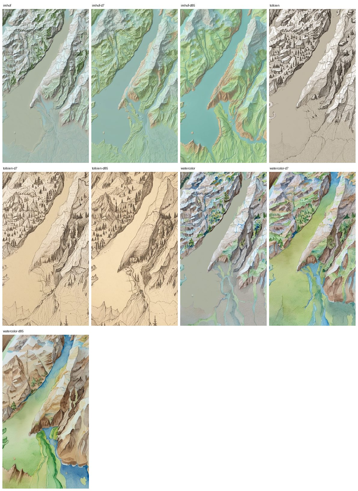
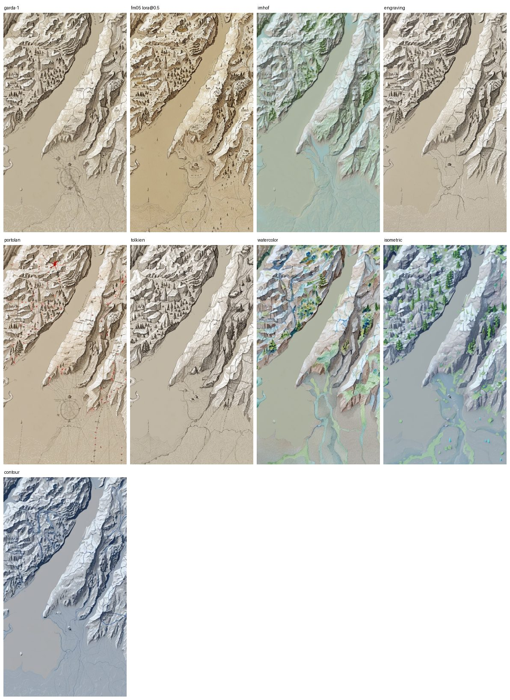
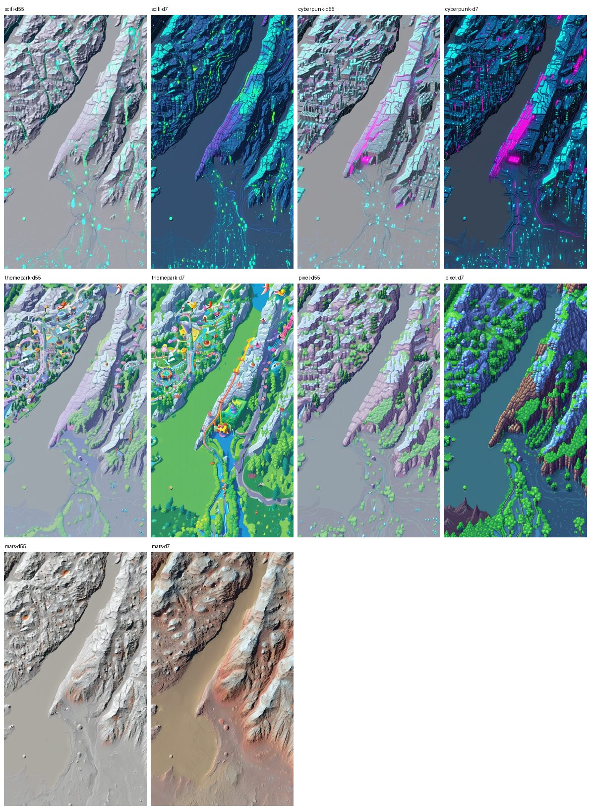
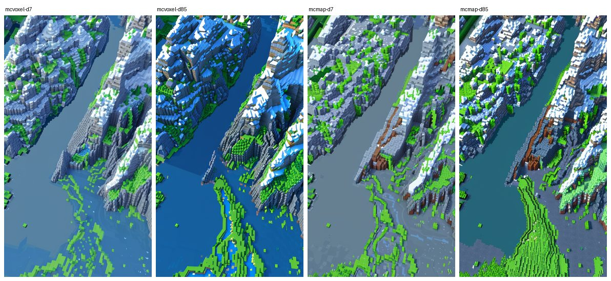
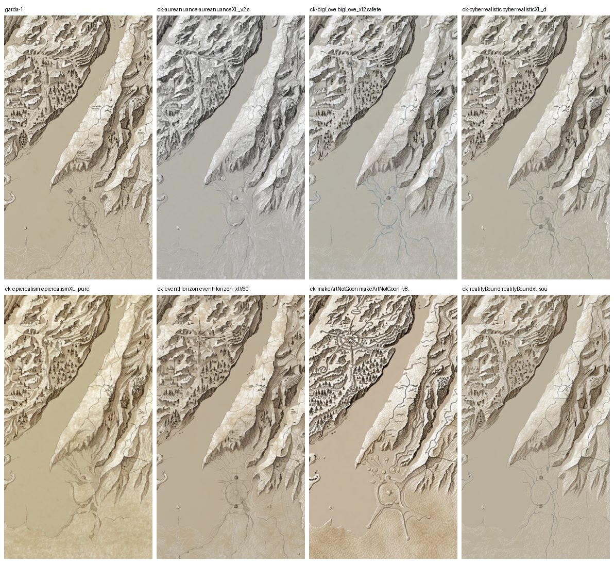
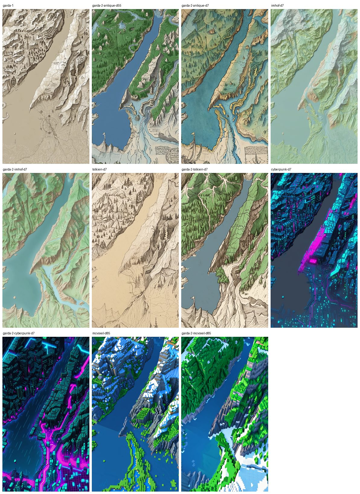

# Styles and the knobs that matter

What the early bakes showed about prompts, checkpoints, denoise, the composite and the presets. All sweeps below hold the controls and the seed fixed (`bake --out <variant> --seed 7` copies the controls), so only the painting changes. The alignment gate is a grid check and passes every one of them; feature fidelity is a visual check, best judged draped in `examples/viewer.html` rather than as PNGs.

How to get to a first bake is in [`your-first-bake.md`](https://github.com/smk762/argus-atlas/blob/main/docs/your-first-bake.md).

## Denoise matters most

Checkpoint matters less than prompt, which matters less than denoise.

- **0.55:** the hillshade dominates. The prompt changes palette and texture, not structure.
- **0.7:** a stronger illustrated look with the same geometry. A good default for the composite template.
- **0.85:** Imhof paints the lake teal and the lowland green on its own, and Tolkien becomes a real pen-and-ink with profile mountains and hatched hills. Ridges and the shoreline still hold, but watercolor invents a river across the lake: at that denoise the ControlNet (strength 0.65, end 0.8) no longer pins the flat areas. Raise `strength`/`end_percent` in the template, or use the composite, before going that high.

If relief is washed out, raise ControlNet `strength` or lower `--denoise`; if the output ignores the prompt, do the opposite.

## Prompts

Imhof (muted greens, a pale blue cast) is the most atlas-like; Tolkien gives clean monochrome pen-and-ink; engraving is the base look with fewer stray symbols; portolan picks up red rhumb lines and a compass rose but is messy; watercolor has the strongest palette and invents streams in plains; isometric reads as a 3D render; contour is only a blue tint, with no contour lines.

"No compass rose" in the positive prompt does nothing: diffusion models do not negate. Put unwanted symbols (`compass rose`, `cartouche`, `sea monster`, `ship`) in the negative, which is what the `antique` and `tolkien` presets do. On `tolkien`, `sea monster` and `ship` in the negative flattened the inked sea, so that preset keeps only the rose terms.

Themed styles (sci-fi, cyberpunk, theme park, 16-bit pixel, Mars, Minecraft) land fully from denoise 0.7, with `parchment, paper, sepia, antique` added to the negative: cyberpunk draws a neon street grid along the roads, pixel and Minecraft paint water blue with grass, stone and snow bands by elevation. The ControlNet keeps the shoreline and ridges in all of them.

## Checkpoints

Realism checkpoints (aureanuance, bigLove, cyberrealistic, epicrealism, eventHorizon, realityBound) all give the same monochrome hillshade-on-paper look. `makeArtNotGoon_v8` is the outlier: warm parchment, trees, varied linework, the most "fantasy map" of the set. A diffusers-format folder cannot be loaded by `CheckpointLoaderSimple`; use a single `.safetensors` file.

## The composite: tell the model where water is

From the hillshade alone, a lake is the same parchment tone as the plain around it and lowlands get invented features: the model has no idea where water, forest or towns are. `osm` layers burnt into `composite.png` and fed as the img2img init (the `comfyui_sdxl_img2img_composite_nolora.json` template) fix that, while the ControlNet keeps reading the hillshade.

- Lakes are water in every style, with the OSM shoreline, and rivers are rivers rather than valley texture.
- Forests sit where OSM has them (Tolkien draws tree clusters, Imhof green relief).
- Roads are traced; cyberpunk turns them into its neon grid, which is the right behaviour for that style.
- On coasts, `--sea-level 0` adds a `sea` mask from the DEM (OSM has no ocean polygons; GLO-30 puts the sea at 0 m). That mask is what makes islands and sounds read as water in every style.

## The presets

`argus-atlas presets` lists them. The six marked `recommended` (`antique`, `imhof`, `tolkien`, `watercolor`, `minecraft`, `pixel`, the menu `flow.html?lock=1` shows) held up on every test AOI: a lake in the Alps, an urban coast, a small island, a sound with harbours, and an inland range. `cyberpunk` is kept but not recommended: spectacular over a city, flat over bush with no road grid to turn neon. All assume the composite init, an SDXL checkpoint and no LoRA.

## A cartography LoRA

The Fantasy Map LoRA at weight 0.8 gives the strongest "illustrated atlas" look (villages, trees, figures), but the shoreline softens and parts of a lake are painted as land: the LoRA fights the ControlNet. At 0.5 it keeps the style with shorelines and ridges as crisp as the no-LoRA bake. Start there.

## Seams between chunks

Measured on a 3x3 block of 1024 px chunks as the mean RGB step across a chunk edge divided by the step between adjacent pixels inside a chunk (1.0 = invisible), same seeds in every pass:

| pass | ratio |
|---|---|
| no neighbours | 6.3 |
| neighbours pasted, hard mask, no blend | 4.5 |
| + soft mask, tone, full-resolution residual | 1.9 (streaks along coasts) |
| + residual low-passed only | 3.6 (no streaks, the line is back) |
| + two-scale residual (the shipped defaults) | 2.0 (no streaks, a faint line) |

Rivers and coastlines continue across every seam once neighbours are pasted; the blend removes the colour step in open water and most of the line. What is left is model variance: two neighbours can still be painted in a slightly different hand, which no pixel blend fixes.

## What only a real bake caught

- `gdal_rasterize` never reprojects: `-a_srs` only labels the output. Every vector now goes through `ogr2ogr -t_srs EPSG:3857 -clipdst` first.
- Overpass output order matters to GDAL's OSM driver: ways printed before their nodes are dropped, giving empty layers and an all-grey composite. The query ends with `(._;>;);out body;`. Check `ogrinfo -so <layer>.geojson` shows features before burning.
- `gdal_proximity` and `gdal_fillnodata` write scratch files into the working directory, which is not writable in the image as a non-root uid.
- A stacked VRT has no colour interpretation, so `gdalbuildvrt` refused to mosaic blended crops with unblended ones until the blend was labelled RGB.
