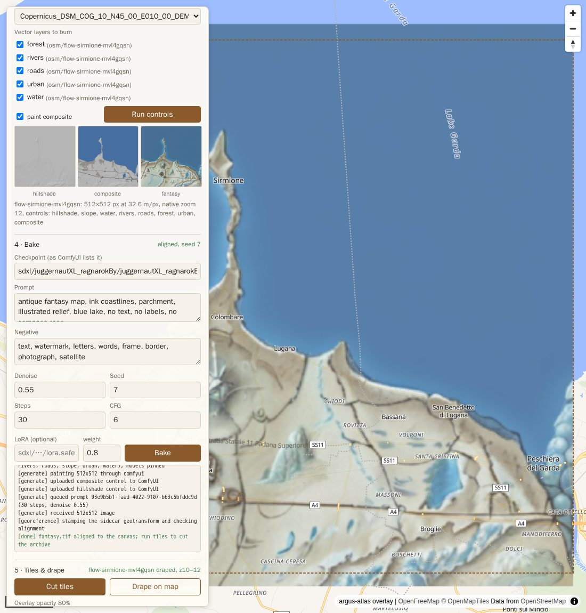

# Your first bake

A walk-through for the first real bake on a GPU host running ComfyUI, from an empty model tree to a draped map. It runs every atlas command from the image with `docker compose`, so the host needs Docker but not GDAL. The host-side paths come from your `.env` (see [`.env.example`](https://github.com/smk762/argus-atlas/blob/main/.env.example)):

| Placeholder | `.env` variable | Mounted in the container at |
|---|---|---|
| `<GPU_HOST>` | `COMFYUI_BASE_URL` (when ComfyUI is on another machine) | — |
| `$ATLAS_DEM_HOST` | DEMs, land polygons, OSM extracts | `/data/dem` |
| `$ATLAS_RECIPES_HOST` | style recipes and patched templates | `/data/recipes` (read-only) |
| `$ATLAS_MODELS_HOST` | the model tree ComfyUI loads from (`checkpoints/`, `loras/`) | `/data/models` (read-only) |
| `$ATLAS_JOBS_HOST` | job directories | `/data/out/atlas` |

What a bake looks like once it works, and which knobs matter, is in [`styles.md`](https://github.com/smk762/argus-atlas/blob/main/docs/styles.md).

## What ComfyUI needs

- **ComfyUI** reachable from the atlas container: on the same host, the default `COMFYUI_BASE_URL=http://host.docker.internal:8188` works (compose adds the host-gateway alias); on another machine, `http://<GPU_HOST>:8188` with ComfyUI started with `--listen`. `docker compose run --rm atlas doctor` reports whether it answers.
- **An SDXL checkpoint.** The bakes in the README use Juggernaut XL (`sdxl/juggernautXL_ragnarokBy/juggernautXL_ragnarokBy.safetensors`). Names are given exactly as ComfyUI lists them, relative to `checkpoints/` or `loras/`.
- **A depth-capable SDXL ControlNet.** Recommended: xinsir's controlnet-union SDXL, promax variant (~2.5 GB, depth, canny and tile in one):

  ```bash
  mkdir -p "$ATLAS_MODELS_HOST/controlnet/controlnet-union-sdxl"
  curl -L -o "$ATLAS_MODELS_HOST/controlnet/controlnet-union-sdxl/diffusion_pytorch_model_promax.safetensors" \
    https://huggingface.co/xinsir/controlnet-union-sdxl-1.0/resolve/main/diffusion_pytorch_model_promax.safetensors
  ```

  ComfyUI lists it as `controlnet-union-sdxl/diffusion_pytorch_model_promax.safetensors` without a restart. A lighter alternative is `diffusers/controlnet-depth-sdxl-1.0` (~1.2 GB).
- **No LoRA** is needed for a first bake: use the `_nolora` templates.

atlas pins the checkpoint and LoRA by SHA256, so `$ATLAS_MODELS_HOST` must be **the same tree ComfyUI loads them from**. The resolver takes one root. If ComfyUI merges several trees (`extra_model_paths.yaml`), point atlas at the one that holds the checkpoint you name, and keep LoRAs in that same tree.

## Point a template at your ControlNet

The packaged templates name a placeholder ControlNet, `diffusers_xl_depth_full.safetensors`. ComfyUI rejects it with `value_not_in_list` unless you have that file, so render a copy and edit its `ControlNetLoader` node:

```bash
for t in EXAMPLE_TEMPLATE_COMPOSITE EXAMPLE_TEMPLATE_SEAM_NOLORA; do
  docker compose run --rm atlas python -c \
    "import argus_atlas.backends.workflow as w, json; print(json.dumps(w.example_template(w.$t), indent=2))"
done
```

Save the first output as `$ATLAS_RECIPES_HOST/atlas-composite.json` and the second as `$ATLAS_RECIPES_HOST/atlas-seam-nolora.json`, then in both:

```bash
sed -i 's|diffusers_xl_depth_full.safetensors|controlnet-union-sdxl/diffusion_pytorch_model_promax.safetensors|' \
  "$ATLAS_RECIPES_HOST"/atlas-*.json
```

`strength` (0.65) and `end_percent` (0.8) in that node are the ControlNet knobs; they live in the template on purpose. `bake` uses `--workflow` (or `ATLAS_WORKFLOW`); `chunk` and `chunks` ignore both and use the recipe's `workflow`, a path relative to the recipe file, so set `"workflow": "atlas-seam-nolora.json"` in your copy of `examples/recipes/antique.json`.

## One canvas, end to end

```bash
cp .env.example .env            # UID/GID, the *_HOST paths, COMFYUI_BASE_URL
docker compose build
docker compose run --rm atlas doctor

BBOX=10.55,45.40,10.95,45.90    # Lake Garda: strong relief and a shoreline, so "it lines up" is visible
docker compose run --rm atlas dem --bbox $BBOX --out /data/dem/garda.tif
docker compose run --rm atlas osm --bbox $BBOX --zoom 11 --layers water,rivers,roads,forest,urban --out /data/dem/osm/garda
docker compose run --rm atlas controls --dem /data/dem/garda.tif --bbox $BBOX --out /data/out/atlas/garda \
  --layer water=/data/dem/osm/garda/water.geojson --layer rivers=/data/dem/osm/garda/rivers.geojson \
  --layer roads=/data/dem/osm/garda/roads.geojson --layer forest=/data/dem/osm/garda/forest.geojson \
  --layer urban=/data/dem/osm/garda/urban.geojson
# Open $ATLAS_JOBS_HOST/garda/hillshade.png and composite.png before spending a bake.

docker compose run --rm -e ATLAS_ALLOW_BAKE=1 atlas bake /data/out/atlas/garda \
  --preset antique --seed 7 \
  --checkpoint sdxl/juggernautXL_ragnarokBy/juggernautXL_ragnarokBy.safetensors \
  --models-dir /data/models --workflow /data/recipes/atlas-composite.json
docker compose run --rm atlas tiles /data/out/atlas/garda
docker compose run --rm atlas inspect /data/out/atlas/garda
```

For a coast, add `--sea-level 0` to `controls`: OSM has no ocean polygons, and GLO-30 puts the sea at 0 m, so the `sea` mask comes from the DEM. A variant bake that keeps the controls: `bake ... --out /data/out/atlas/garda-s9 --seed 9`.

## Check it

- `fantasy.tif` exists and `inspect` shows `aligned=True` with the checkpoint SHA256. If the gate failed, there is a `fantasy.png` and no GeoTIFF; see the README's *When it fails*.
- Drape it: `docker compose up -d serve` with `ATLAS_CORS_ORIGINS='*'`, serve `examples/` with any static server (`python3 -m http.server 8106 --directory examples`), and open `viewer.html?server=http://<host>:8105&job=garda`. Slide the opacity: coastline and ridges must line up with the basemap. `flow.html?server=...` runs the whole flow from the browser when the server has `ATLAS_ALLOW_BAKE=1` and `ATLAS_ALLOW_OSM=1`, with `$ATLAS_DEM_HOST` writable (`POST /osm` writes under `/data/dem/osm/`).

  
- Every output carries its request: `exiftool fantasy.png` (ImageDescription), `gdalinfo fantasy.tif` (`TIFFTAG_IMAGEDESCRIPTION`), and the `argus_bake` key in the PMTiles metadata.

## Chunks

Once one canvas looks right, grow a region from a recipe:

```bash
docker compose run --rm -e ATLAS_ALLOW_BAKE=1 atlas chunks \
  --tile 10/1009/640 --rings 1 --recipe antique --sea-level 0 --allow-missing \
  --land /data/dem/land.gpkg --out /data/out/atlas/antique
docker compose run --rm atlas mosaic /data/out/atlas/antique --out /data/out/atlas/antique.pmtiles
```

The block's DEM and OSM layers are fetched once into `<out>/.block`; `--land` (any land polygon file, e.g. Natural Earth 10m land) only skips chunks with no land in their tile. `--plan` prints the chunks and their seam order without baking; `--controls-only` stops before the GPU. A re-run skips finished chunks, so it resumes after a failure. See the README's *Chunks and style recipes*.

## Operational notes

- **The first bake is slow, later ones are not.** Expect several minutes on the queue for the first bake while ComfyUI loads the checkpoint and the ControlNet from a cold page cache; the 30 sampling steps themselves take seconds on a 24 GB card. With ComfyUI warm, a canvas bake plus tiles takes 20–45 s, and a 1024 px chunk 45–55 s.
- **If ComfyUI restarts mid-bake** (an idle watcher, an OOM), the queued prompt disappears; the backend notices it is in neither `/queue` nor `/history` and fails instead of waiting out the timeout. Re-run the bake.
- **Don't rely on ComfyUI's output directory.** atlas copies the painted PNG into the job dir; that copy is the one that is stamped and gated.
- **Run the containers as your uid** (compose does, from `UID`/`GID`), or job dirs end up owned by root.
- **Checkpoint verification re-hashes the model** in each container, a few seconds per bake for a 6–7 GB checkpoint.

## A cartography LoRA

No public cartography LoRA is on Hugging Face; Civitai has several SDXL ones ("Fantasy Map", "LargeFantasyCityMap", "OgMapTerrainPatch"). [`scripts/fetch_civitai_lora.py`](https://github.com/smk762/argus-atlas/blob/main/scripts/fetch_civitai_lora.py) lists and downloads them with a `.civitai.json` sidecar (ids, base model, trigger words, licence flags):

```bash
python3 -I scripts/fetch_civitai_lora.py --list 382959
CIVITAI_TOKEN=... python3 -I scripts/fetch_civitai_lora.py --out ./models 382959
rsync -av ./models/loras/ <GPU_HOST>:"$ATLAS_MODELS_HOST"/loras/
```

Bake with the LoRA template (`EXAMPLE_TEMPLATE`, patched as above), `--lora <name> --lora-weight 0.5`, and the LoRA's trigger word in `--prompt`. At 0.8 the Fantasy Map LoRA starts to fight the ControlNet (shorelines soften); 0.5 keeps its style with crisp geometry.
